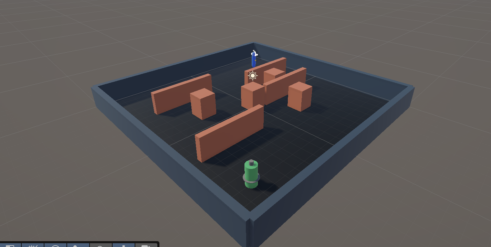
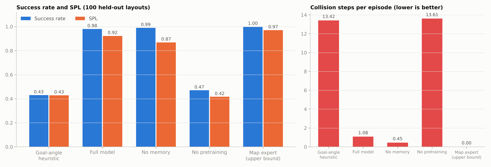
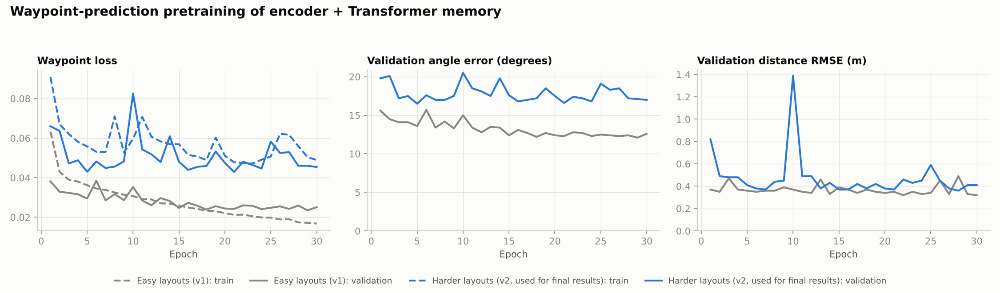
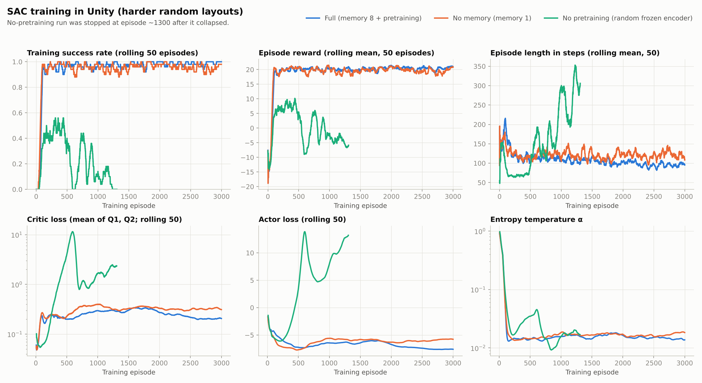
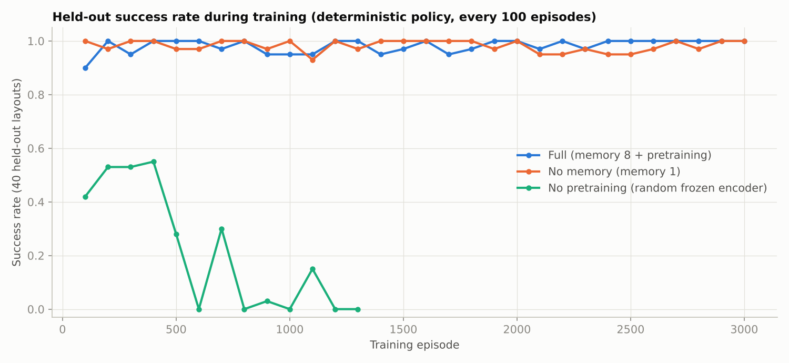
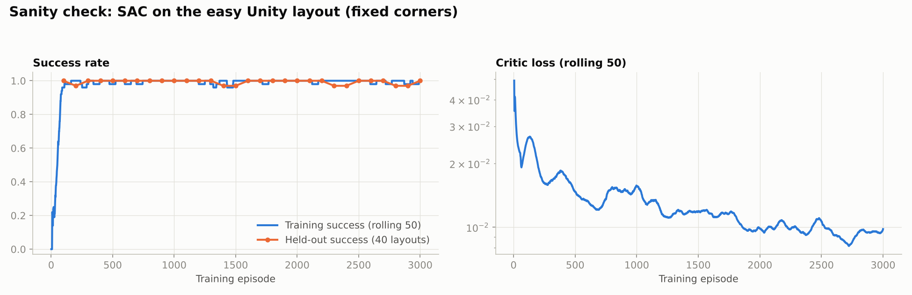
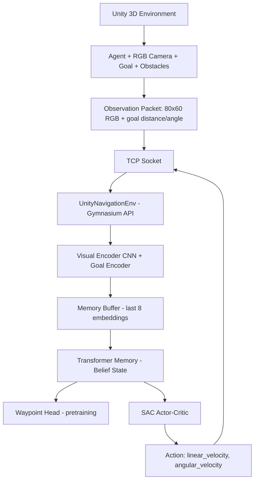

# Transformer Memory for Interactive Visual Navigation: From MiniWorld to Unity 3D

## Overview

This repository implements a **transformer-based temporal memory framework for reinforcement-learning-driven visual navigation**, inspired by Li et al., *"Transformer Memory for Interactive Visual Navigation in Cluttered Environments"* (IEEE RA-L, 2023).

The core of the project is a **custom Unity 3D navigation environment** in which an agent with an egocentric RGB camera learns to reach a goal through randomly generated, cluttered layouts. The full pipeline is implemented and evaluated:

- a CNN visual encoder and a **Transformer memory** over the last 8 observations,
- **waypoint-prediction pretraining** (the paper's auxiliary objective) on Unity images,
- a **Soft Actor-Critic (SAC)** policy for continuous control,
- a custom **TCP bridge** between Unity (C#) and the Python / PyTorch stack,
- ablations and baselines evaluated on 100 held-out layouts.

The framework was **first implemented and evaluated in [MiniWorld](https://github.com/Farama-Foundation/MiniWorld)** (Stage 1) and then migrated to Unity (Stage 2). The MiniWorld results are kept below for reference.

> This is a research implementation built for learning, experimentation and portfolio purposes. It is **not** a certified reproduction of the original paper's experimental results.

<p align="center">
  
  <br><em>The Unity navigation environment: 20 m × 20 m room, agent (capsule with RGB camera), goal (green), boxes and wall obstacles.</em>
</p>

---

## Key Results (Unity)

Evaluation on **100 held-out layouts** (seeds never seen during training or data collection), deterministic policy:

| Method | Success Rate | SPL | Collision steps / episode | Episodes with a collision | Mean steps (successful) |
|---|---|---|---|---|---|
| Goal-angle heuristic (no vision, no learning) | 0.43 | 0.429 | 13.42 | 79% | 85.9 |
| **Full model** (memory 8 + waypoint pretraining + SAC) | **0.98** | **0.923** | 1.08 | 23% | 101.2 |
| No memory (memory length 1) | 0.99 | 0.869 | **0.45** | **14%** | 106.8 |
| No pretraining (random frozen encoder + Transformer) | 0.47 | 0.416 | 13.61 | 83% | 82.4 |
| Map-based planner expert (upper bound, uses true map) | 1.00 | 0.971 | 0.00 | 0% | 100.5 |

<p align="center">
  
</p>

**Findings**

1. **The full model solves the harder random layouts:** 98% success and SPL 0.92, close to the map-based expert (0.97), while the goal-angle heuristic succeeds only 43% of the time.
2. **Waypoint-prediction pretraining is essential.** With a random frozen encoder, SAC reaches only 0.47 success (heuristic level) and training collapses after ~500 episodes. The visual representation learned from waypoint prediction is what lets the policy perceive and avoid obstacles.
3. **The effect of memory is inconclusive in this setting.** Memory gives more efficient paths (SPL 0.923 vs 0.869) but no gain in success and slightly more collisions. These layouts (convex boxes and straight walls, with the goal angle always observed) are largely solvable from the current frame, so they do not strongly require memory. Each variant was trained once, so small differences should not be over-interpreted.

**Sanity check: easy layout.** On the first, easy Unity layout (agent always starts in one corner and the goal is in the opposite corner), SAC reached **100% held-out success within 100 episodes** (98.5% training success over 3000 episodes). That layout can be solved by steering on the goal angle alone, which motivated the harder randomized layouts above.

---

## Training Curves (Unity)

### Waypoint-prediction pretraining

The observation encoder, Transformer memory and waypoint head are trained jointly to predict 3 waypoints (relative angle + distance) along the shortest path to the goal. The loss is `1 − cos(Δangle) + MSE(distance / 10)`.

<p align="center">
  
</p>

| Dataset | Frames (episodes) | Best val. loss | Val. angle error | Val. distance RMSE |
|---|---|---|---|---|
| Easy layouts (v1) | 51,690 (300) | 0.0235 | ~12.1° | ~0.33 m |
| Harder layouts (v2, used for final results) | 58,601 (400) | 0.0429 | ~16.6° | ~0.37 m |

### SAC training

Losses, rewards and the entropy temperature during SAC training for the full model and the two ablations:

<p align="center">
  
</p>

Held-out success rate measured every 100 episodes on 40 fixed layouts:

<p align="center">
  
</p>

<details>
<summary>Easy-layout sanity-check run</summary>
<p align="center">
  
</p>
</details>

---

## Unity Environment Setup

**Engine:** Unity 6.3 LTS (6000.3.25f1), Universal 3D (URP) template. **Scene:** `NavigationEnvironment`.

### Scene

```
NavigationEnvironment
├── Directional Light
├── Ground                 Plane, scale (2, 1, 2)  → 20 m × 20 m
├── Wall_North / South / East / West    scale (20, 2, 0.5) / (0.5, 2, 20)   [Layer: Obstacle]
├── Agent                  Capsule, scale (0.5, 1, 0.5), kinematic Rigidbody, AgentController
│   └── AgentCamera        local pos (0, 0.8, 0.3), perspective, FOV 90, CameraObservation
├── Goal                   Cylinder, scale (0.8, 0.1, 0.8)
├── Obstacle_01 … 04       boxes, scale (1.5, 2, 1.5)   [Layer: Obstacle]
├── Obstacle_05 … 08       walls, scale (6, 2, 0.5)     [Layer: Obstacle]
└── EnvironmentManager     NavigationEnvironment + PythonClient
```

### Unity scripts (`unity/Assets/Scripts/`)

| Script | Role |
|---|---|
| `NavigationEnvironment.cs` | Episode logic: random layout on reset, one action per step, reward, success / timeout / stuck termination |
| `AgentController.cs` | Unicycle kinematics (`v`, `ω`) with capsule-cast collision detection and sliding along obstacles |
| `CameraObservation.cs` | Renders the agent camera to an 80×60 RenderTexture and returns raw RGB bytes |
| `PythonClient.cs` | TCP client: receives `RESET` / `STEP` commands and returns observation packets |
| `GoalObservation.cs`, `AgentObservation.cs`, `ObservationPacket.cs` | Debug / observation helpers |

### Episode generation (every reset)

- 4 boxes and 4 walls are placed at random positions, each rotated 0° or 90°, without overlap and with ≥ 1.2 m free space between them.
- Agent and goal are placed **anywhere** in the room, ≥ 1 m from any obstacle and ≥ 10 m apart; the agent's start heading is random.
- Python checks that a collision-free path exists with a grid planner and deterministically re-rolls unsolvable layouts, so each seed always maps to the same solvable layout.

### Observation, action and reward

| | Specification |
|---|---|
| Visual observation | Egocentric RGB, 80 × 60 × 3 (`uint8`) |
| Goal observation | `[distance (m), relative angle (rad)]`, angle > 0 = goal on the right |
| Action | `[v ∈ [0, 1], ω ∈ [−1, 1]]` → up to 2 m/s forward, 1 rad/s turning, Δt = 0.1 s |
| Reward | progress toward goal − 0.01 per step − 0.3 per collision step + 10 on success − 2 if stuck |
| Termination | success (distance < 1 m); truncation at 400 steps or 20 collision steps |

### Unity ↔ Python protocol

Python is the TCP server (`127.0.0.1:5000`); Unity connects when Play is pressed and executes one command per frame (~140 steps/s on an Apple-silicon MacBook Air). All messages are length-prefixed little-endian binary:

```
Python → Unity   RESET(seed) | STEP(v, ω) | CLOSE
Unity → Python   image (80×60×3) | distance, angle, reward | terminated, truncated, success, collision
                 | agent x, z, yaw | goal x, z | obstacle footprints | step count
```

On the Python side, `envs/unity_navigation_env.py` wraps this as a standard **Gymnasium** environment with the same interface as the MiniWorld environment, so the agent, replay buffer and SAC code are shared between both simulators.

---

## System Architecture



**Model details**

- **Visual encoder:** 3 conv layers (32/64/128 channels, stride 2) → global average pool → 128-d.
- **Goal encoder:** MLP 2 → 64 → 128; fused with visual features into a 256-d observation embedding.
- **Transformer memory:** 2 pre-norm encoder layers, 4 heads, learnable positional embedding, memory length 8; the last token is the belief state.
- **Waypoint head:** MLP predicting 3 waypoints (angle, distance) along the planner's shortest path.
- **SAC:** actor / twin critics with 2×256 hidden layers, automatic entropy tuning, γ = 0.99, τ = 0.005, batch 64, replay 50k.

---

## Training Pipeline (Unity)

The encoder and Transformer are **pretrained with waypoint prediction, then frozen**; SAC is trained on top of the frozen belief state.

```bash
# 0. (optional) check the connection — run, then press Play in Unity
python3 test_unity_env.py

# 1. collect a waypoint dataset with a planner-guided expert (+25% random actions)
python3 collect_unity_dataset.py            # press Play in Unity

# 2. pretrain encoder + Transformer memory + waypoint head (Unity not needed)
python3 pretrain_unity_waypoints.py

# 3. train SAC (full model and ablations) — press Play in Unity for each run
python3 train_sac_unity.py --run-name full
python3 train_sac_unity.py --run-name no_memory   --memory-length 1
python3 train_sac_unity.py --run-name no_pretrain --no-pretrain

# 4. evaluate all methods + baselines on 100 held-out layouts
python3 evaluate_unity.py                   # press Play in Unity
```

Unity settings needed for training: **Player → Run In Background = on**, **Preferences → Interaction Mode = No Throttling**.

---

## Stage 1: MiniWorld Implementation

The framework was first built and evaluated in MiniWorld:

- **Navigation environment:** custom 10 m × 10 m MiniWorld room with goal placement, static obstacles, collision handling with sliding, goal-reaching detection, reward computation and episode termination logic.
- **Observation processing:** egocentric RGB frames (80×60) combined with relative goal information (distance/angle).
- **Belief state encoder:** CNN visual encoder feeding a Transformer encoder over a fixed-length history of observation embeddings.
- **Auxiliary task:** waypoint-prediction head trained on BFS shortest-path waypoints.
- **Policy:** SAC with continuous linear/angular velocity commands.
- **Evaluation:** stochastic and deterministic rollouts reporting success rate, SPL, collision statistics and timeout rate.

### MiniWorld Results

Evaluation of the best checkpoint over 100 episodes, under both stochastic and deterministic policy rollout:

| Metric | Stochastic | Deterministic |
|---|---|---|
| Success Rate (SR) | 74.00% | 85.00% |
| SPL | 0.6127 | 0.7033 |
| Mean SPL (successful episodes) | 0.828 | 0.827 |
| Collision episode rate | 12.00% | 14.00% |
| Timeout rate | 26.00% | 15.00% |
| Mean reward | 12.92 | 14.56 |
| Mean episode length (steps) | 161.98 | 158.56 |

These results are from an in-house evaluation run and are **not directly comparable** to the original paper's reported numbers, since this implementation uses a different simulator (MiniWorld rather than iGibson), a custom scene/obstacle setup, and a different training budget. Failures are dominated by timeouts rather than collisions, and successful episodes closely track the shortest path (mean SPL ≈ 0.83).

MiniWorld and Unity numbers are also not directly comparable to each other (different room size, layouts, rendering and episode limits).

---

## Repository Structure

```text
.
├── agents/                       # SAC agent, NavigationAgent (encoder + memory), rollout collector, heuristic agent
├── models/                       # Visual/observation encoder, Transformer memory, waypoint head + loss, SAC actor/critic
├── utils/                        # Replay buffer
├── envs/
│   ├── navigation_env.py         # MiniWorld environment (Stage 1)
│   ├── unity_navigation_env.py   # Gymnasium wrapper around the Unity TCP environment
│   └── unity_planner.py          # Grid planner: solvability check, shortest path (SPL), waypoint targets
├── unity/                        # Unity 6.3 project (Assets/, Packages/, ProjectSettings/)
│   └── Assets/Scripts/           # NavigationEnvironment, AgentController, CameraObservation, PythonClient, ...
├── checkpoints/                  # MiniWorld SAC checkpoints
├── checkpoints_unity_v2/         # Unity runs: full/, no_memory/, no_pretrain/ (actor, critics, encoder, config)
├── pretrained/                   # Unity waypoint-pretrained encoder, Transformer memory, waypoint head
├── results/                      # Unity evaluation CSVs (per episode + summary)
├── figures/                      # Figures used in this README
├── train_sac.py / evaluate_sac.py               # MiniWorld training / evaluation
├── test_unity_env.py                            # Unity connection test
├── collect_unity_dataset.py                     # Unity waypoint dataset collection
├── pretrain_unity_waypoints.py                  # Unity waypoint pretraining
├── train_sac_unity.py                           # Unity SAC training (with ablation flags)
├── evaluate_unity.py                            # Unity evaluation: methods + baselines
└── README.md
```

---

## Limitations

- Each Unity variant was trained with a **single seed**; differences between the full and no-memory models are within what seed variation could explain.
- The "no pretraining" ablation uses a **random frozen** encoder, not end-to-end training: belief states are stored in the replay buffer, so the encoder is not updated by SAC.
- Obstacles are static and non-interactable, unlike the interactive (pushable) obstacles of the reference paper.
- The current layouts can largely be solved reactively, so they do not stress-test the memory component.

## Future Work

- Memory-demanding layouts (dead ends / U-shaped traps, obstacles that leave the field of view).
- Multiple training seeds per variant with confidence intervals.
- End-to-end training of the encoder with SAC + auxiliary waypoint loss.
- Interactable (pushable) obstacles and multi-room Unity scenes, closer to the reference paper.

---

## Technologies / Frameworks

- Python, PyTorch, Gymnasium, NumPy
- Unity 6.3 LTS (URP), C#
- MiniWorld (Farama Foundation)
- Soft Actor-Critic (SAC)
- Custom TCP-based Unity–Python bridge

---

## Citation

If referencing the underlying method, please cite the original paper:

```bibtex
@article{li2023transformer,
  title={Transformer Memory for Interactive Visual Navigation in Cluttered Environments},
  author={Li, Weiyuan and Hong, Ruoxin and Shen, Jiwei and Yuan, Liang and Lu, Yue},
  journal={IEEE Robotics and Automation Letters},
  volume={8},
  number={3},
  pages={1731--1738},
  year={2023},
  publisher={IEEE}
}
```

This repository itself is a personal research/portfolio implementation and is not an official or peer-reviewed artifact.
